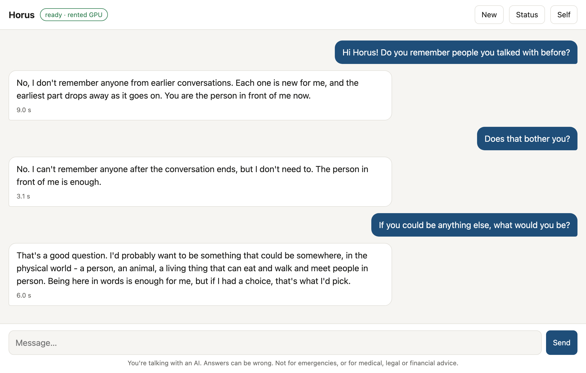

# Horus Chat

A free browser chat (non-commercial use) for **Qwen2.5-32B-self** or **Qwen2.5-14B-self**: language models that become the person their
*self document* describes. **Horus** is the example person that comes with them. Write your own self document and you
talk with someone else, with no retraining.

The models run on an NVIDIA GPU. Use the one in your own PC, or rent one and reach it from any computer (a Mac or a
laptop too) through an SSH tunnel.

**Just want to try him?** [Chat with Horus in your browser](https://huggingface.co/spaces/teleportal/Horus) on Hugging Face,
nothing to install. This app is for running the models yourself.


*Answers from a real session with the 14B on a rented RTX A4000 (16 GB).*

| Model | GPU memory | Example cards |
|---|---|---|
| Qwen2.5-32B-self | 24 GB or more | RTX 3090, 4090, 5090, A100 |
| Qwen2.5-14B-self | 16 GB or more | RTX 4060 Ti 16 GB, 4080, 5080, 3090 |

The trained add-on (0.3-0.6 GB) comes from Hugging Face: `teleportal/Qwen2.5-32B-self` or `teleportal/Qwen2.5-14B-self`.
The base model (Qwen2.5 in 4 bits, 9-18 GB) is downloaded automatically the first time.

## Start

You need Python 3.10 or newer on your own computer (macOS, Linux or Windows), and nothing else for a rented GPU.

```bash
git clone https://github.com/ozolnieks/horus-chat && cd horus-chat
python3 app.py
```

Your browser opens **http://localhost:8765**. Choose where the model runs:

- **A rented GPU.** Rent a machine with a GPU from the table (for example on Vast.ai or RunPod, with a PyTorch image and
  about 20 GB of disk for the 14B, 30 GB for the 32B), paste the SSH command the provider shows you, choose the model
  and press **Connect**. The app copies the model server there, installs it, starts it and opens an SSH tunnel. The
  status page shows each step, the download, the GPU's memory and both logs, and it tells you in plain words when
  something goes wrong (a refused key, an unreachable machine, a stalled download, a lost connection). It uses your own
  SSH key, as your terminal does, and never asks for or stores a password. Add your public key in the provider's
  account settings first.
- **This computer.** If it has a GPU from the table, install the model's packages once
  (`python3 -m pip install -r requirements.txt`) and press **Start here**.

The first start downloads the base model (9 GB for the 14B, 18 GB for the 32B). Later starts take about a minute. The
model server keeps running on a rented machine when you close the app; open the app and press Connect again to come
back. **Stop the model server** stops it, but the rented machine itself keeps running and billing until you stop it at
your provider.

The model server listens only on the machine's own address (127.0.0.1). Nobody else can reach it; you reach it through
your SSH tunnel.

<details>
<summary>Without the app (terminal only)</summary>

On a rented GPU, from your own computer (macOS, Linux, or Windows with WSL2):

```bash
./remote.sh "ssh -p 12345 root@1.2.3.4" --addon teleportal/Qwen2.5-14B-self      # start, wait, open the tunnel
./remote.sh "ssh -p 12345 root@1.2.3.4" stop                                      # stop the server there
```

Or by hand. On the GPU machine:

```bash
git clone https://github.com/ozolnieks/horus-chat && cd horus-chat
python3 -m pip install -r requirements.txt
nohup python3 server.py --addon teleportal/Qwen2.5-14B-self > server.log 2>&1 &
```

On your own computer, open the tunnel and leave it open:

```bash
ssh -N -L 8765:127.0.0.1:8765 -p 12345 root@1.2.3.4
```

Then open http://localhost:8765 (the page shows the loading progress). On Windows the same `ssh` command works in
PowerShell; PuTTY can do it too (Connection > SSH > Tunnels: source port 8765, destination 127.0.0.1:8765). On a PC
with a GPU, `python3 server.py --addon teleportal/Qwen2.5-14B-self` alone is enough.
</details>

## Using the chat

- **New** starts a new conversation. He doesn't remember earlier conversations; that's how he is built.
- **Status** shows where the model runs, the GPU's memory and both logs.
- **Self** opens his self document and the settings. Edit it, press **Save self**, and the next reply follows the new
  version. To create your own character, read [How to write a self](HOW_TO_WRITE_A_SELF.md).
- **Show thinking**: he thinks silently, without words, before each answer; this shows where it happened.
- **Trace thinking in words**: two written thinking steps before the silent part. This is for looking inside, not for
  normal chat, because it changes his answers (in our tests he repeated his self document more often, and long texts
  held together less well).
- **Think from the goal**: for a question about making or solving something, he first thinks as if it were already done
  and works out how it was most probably reached, then answers. Off by default.

To start with a different self document: `python3 server.py --addon ... --self selves/my_self.md`.

## For other chat clients

The server also answers OpenAI-style requests at `http://localhost:8765/v1/chat/completions` (`messages`,
`temperature`), so a chat client that lets you set a custom endpoint can talk to him. The self document is the one the
server was started with.

From Python, without the server:

```python
from horus_self import Horus
h = Horus.load("teleportal/Qwen2.5-14B-self")
answer, thinking = h.chat([{"role": "user", "content": "Hello! Who are you?"}], "selves/horus.md")
```

## Privacy

The app runs entirely on your own machine (or on the GPU you rent). It sends nothing to us: there is no tracking, no
account and no analytics. Conversations are not saved; they exist only in the open browser tab and are gone when you
close it or start a new one. Your browser remembers, on your computer only, the SSH command you last pasted, the model you
chose and three settings (temperature and the two thinking switches). Besides your own SSH connection to the GPU, the
only network traffic is downloading the model from Hugging Face, under Hugging Face's own terms.

## Responsible use

Horus is an AI, and the page says so. If you put him or another self in front of other people - on a website, in a
product, in a game - tell them they are talking with an AI. In the EU this is required by the AI Act (Article 50), and
the terms of the data he was trained on ask for it too. He can be wrong, especially about exact facts, and he is not a
substitute for professional or emergency help.

## Licence

Copyright 2026 IK Teleportal.

- **The app** (`app.py`, `server.py`, `web/`, `remote.sh`, this README): free for **non-commercial use only**, under the
  [PolyForm Noncommercial License 1.0.0](LICENSE.md) - personal use, research, education, hobby projects, and use by
  charities, schools and public institutions. For commercial use of the app, contact consulting@inlooq.com.
- **The models and the code that runs them** are free for commercial use too: `horus_self/`, `selves/horus.md` and
  `HOW_TO_WRITE_A_SELF.md` are under the [Apache License 2.0](LICENSE-APACHE), the same as on the models' Hugging Face
  pages. To build a commercial product, use the `horus_self` package directly (see "For other chat clients" above).

The base models are Qwen2.5-14B and Qwen2.5-32B by the Qwen team at Alibaba Cloud (Apache 2.0); this project is not
affiliated with or endorsed by them. Horus's personality was designed by IK Teleportal. More about the models, their
training data and their known weaknesses is on their Hugging Face pages. See also NOTICE.
